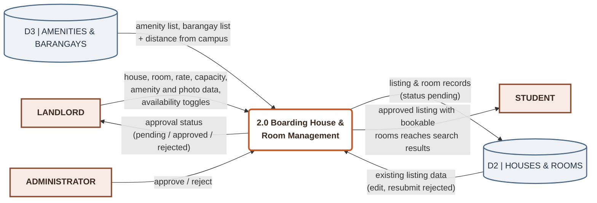
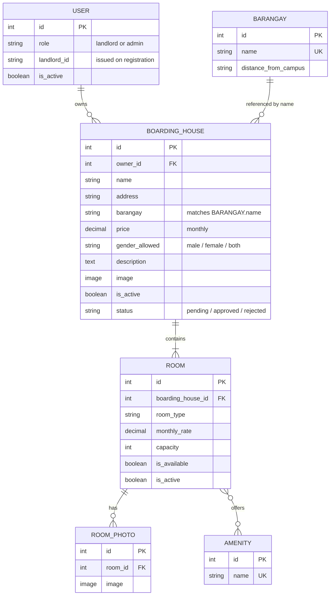
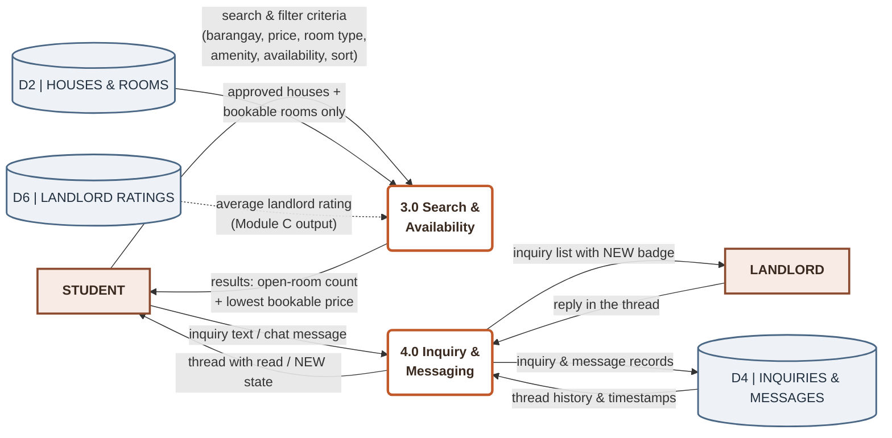
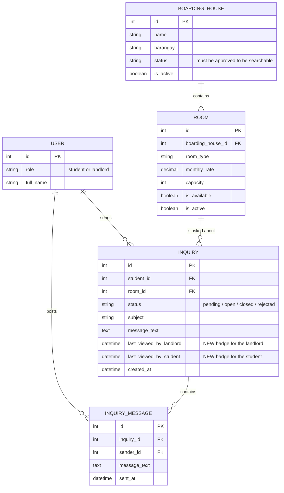
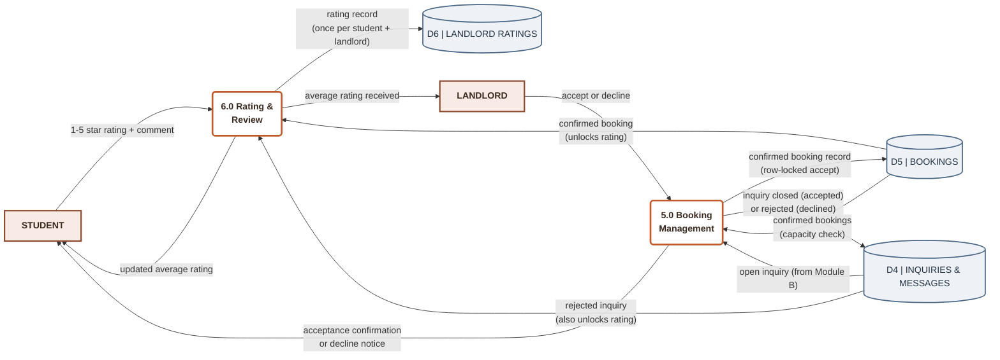
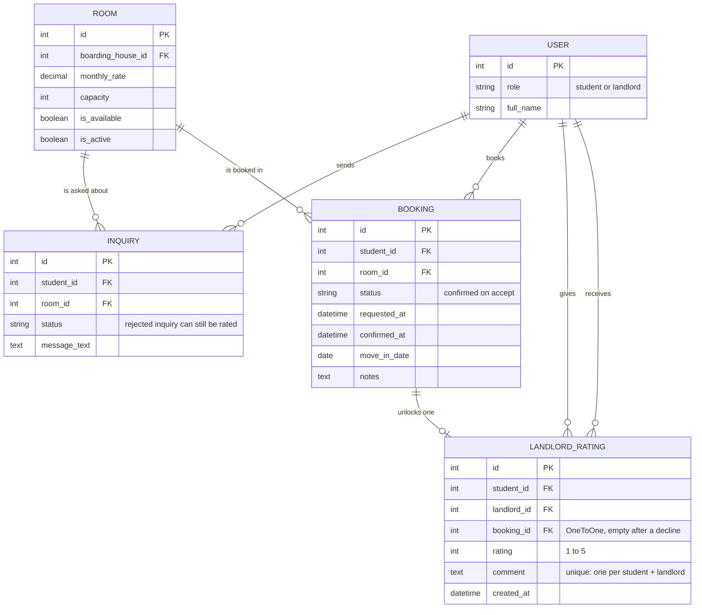
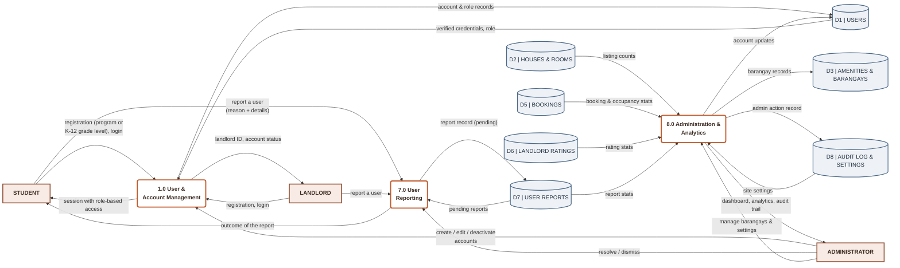
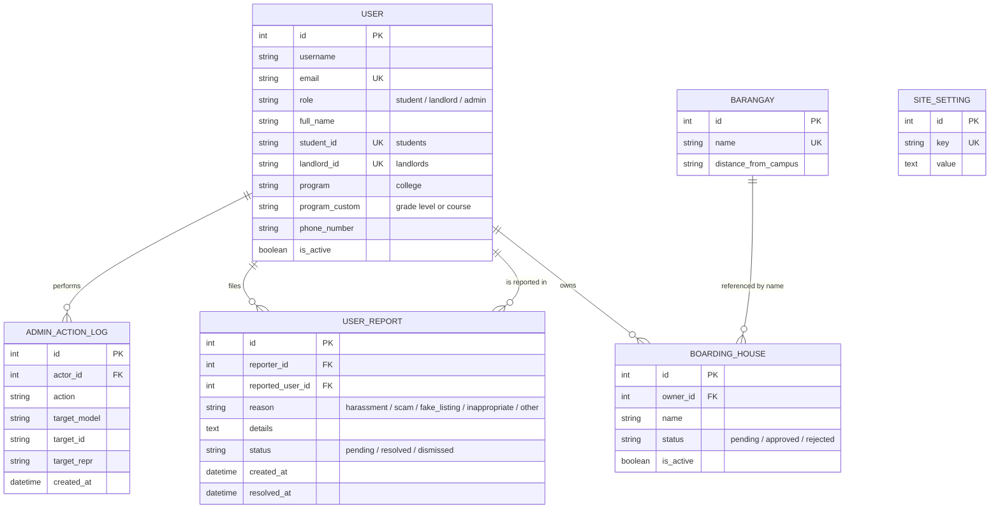

# BHIMS module diagrams - Mermaid source

Every module diagram below is the exact source used to render the PNG beside it.
The `.mmd` file is the source of truth: edit the code, then re-render.

```bat
venv\Scripts\python.exe tools\render_diagrams.py docs\final-project\diagrams
```

Each PNG is rendered at 3x from its matching `.mmd`, so the pair must keep the same name.
Paste any block into https://mermaid.live to preview or export it.

| Owner | Module | Diagram files |
|---|---|---|
| **Noemi** | A - Boarding House & Room Management with Verification | `Module A - Noemi - DFD (Boarding House & Room Management with Verification)` / `Module A - Noemi - ERD (Boarding House & Room Management with Verification)` |
| **mac** | B - Search & Inquiry | `Module B - mac - DFD (Search & Inquiry)` / `Module B - mac - ERD (Search & Inquiry)` |
| **Jerome** | C - Booking, Acceptance & Ratings | `Module C - Jerome - DFD (Booking, Acceptance & Ratings)` / `Module C - Jerome - ERD (Booking, Acceptance & Ratings)` |
| **cjade** | D - Accounts, Administration, Analytics & Reporting | `Module D - cjade - DFD (Accounts, Administration, Analytics & Reporting)` / `Module D - cjade - ERD (Accounts, Administration, Analytics & Reporting)` |

## Module A - Boarding House & Room Management with Verification - Noemi - DFD

`Module A - Noemi - DFD (Boarding House & Room Management with Verification).mmd`



## Module A - Boarding House & Room Management with Verification - Noemi - ERD

`Module A - Noemi - ERD (Boarding House & Room Management with Verification).mmd`



## Module B - Search & Inquiry - mac - DFD

`Module B - mac - DFD (Search & Inquiry).mmd`



## Module B - Search & Inquiry - mac - ERD

`Module B - mac - ERD (Search & Inquiry).mmd`



## Module C - Booking, Acceptance & Ratings - Jerome - DFD

`Module C - Jerome - DFD (Booking, Acceptance & Ratings).mmd`



## Module C - Booking, Acceptance & Ratings - Jerome - ERD

`Module C - Jerome - ERD (Booking, Acceptance & Ratings).mmd`



## Module D - Accounts, Administration, Analytics & Reporting - cjade - DFD

`Module D - cjade - DFD (Accounts, Administration, Analytics & Reporting).mmd`



## Module D - Accounts, Administration, Analytics & Reporting - cjade - ERD

`Module D - cjade - ERD (Accounts, Administration, Analytics & Reporting).mmd`


